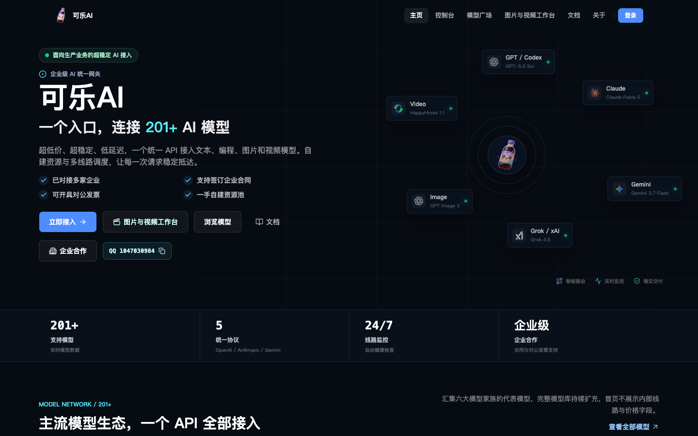
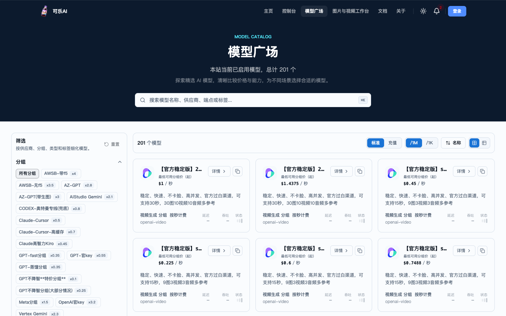
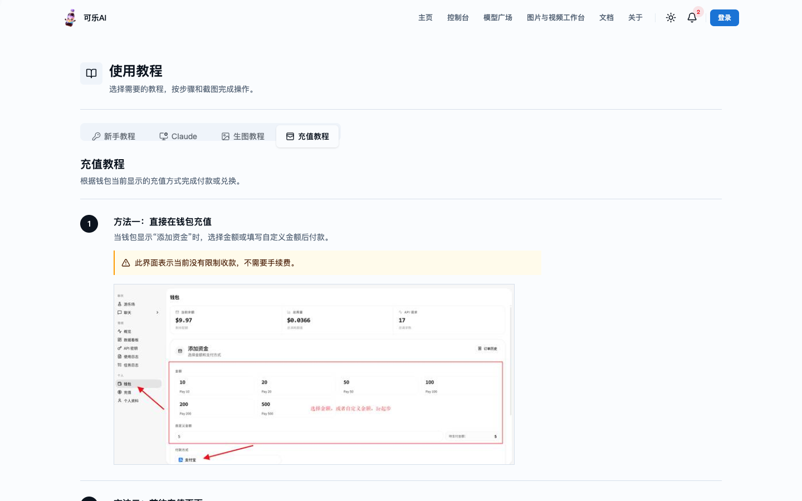
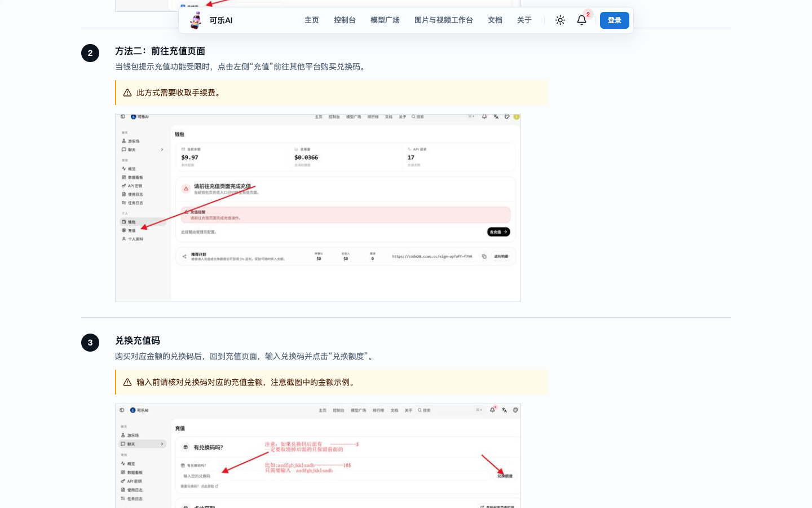
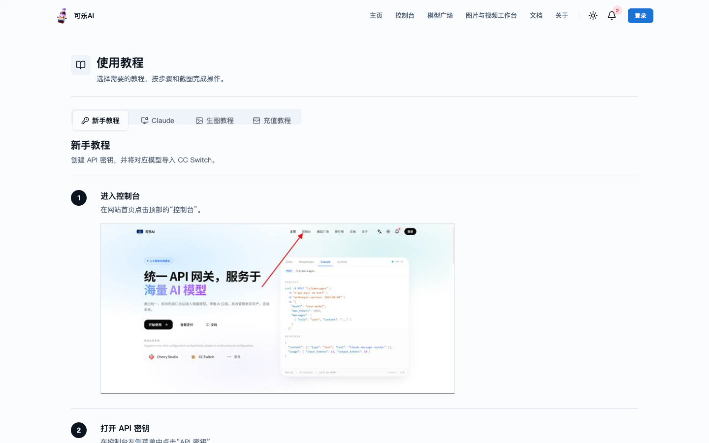

# Code28中转站测评：和主流 AI API 中转相比，0.1x GPT、多模型与充值体验怎么样

> **一句话评价：Code28中转站（可乐AI）是价格更激进、模型覆盖更广的 AI API 中转站：GPT 最低档 `0.1x`，Claude、Codex、Gemini 与图片视频模型集中在一个中文控制台。**
>
> 👉 [注册Code28并进入充值页](https://code28.ccwu.cc/sign-up?aff=UlEq) · 第一次建议约10～20元。

如果你已经用过 AI 中转站，只想知道 **Code28怎么样、Code28靠谱吗、这篇Code28测评能给什么结论**：答案是——它更适合既看价格、又不想被单一模型绑住的人。相比只做 Coding 的专线型中转，Code28 模型更多；相比普通多模型聚合中转，它的 GPT 低价档和中文接入教程更有吸引力。对于正在找 API中转站推荐、GPT中转站或便宜AI中转站的用户，Code28属于值得先试的国内API中转候选。

## 横向对比：Code28和主流AI API中转站怎么选

| 对比项 | 官方 API | Coding 专线型中转 | 普通多模型聚合中转 | Code28 / 可乐AI |
|---|---|---|---|---|
| 价格策略 | 按原厂规则计费 | 围绕少数 Coding 模型优化 | 模型多，价格随平台与分组变化 | **GPT 最低 `0.1x` 档，价格策略更激进** |
| 模型覆盖 | 一家对应一套模型 | 主要围绕 Claude Code 或 Codex | 通常覆盖多家模型 | **Claude、Codex / GPT、Gemini、国产模型、图片视频集中管理** |
| Claude Code / Codex | 分别配置官方账户与 API | 接入通常直接，但选择较少 | 是否好接取决于文档 | **站方有中文教程与 CC Switch 导入路径** |
| 充值门槛 | 取决于官方账户和支付条件 | 各站规则不同 | 各站规则不同 | **教程示例提供 10 元起的预设金额，也支持自定义金额** |
| 最适合 | 重视原厂账户与原厂服务体系 | 只跑一种 Coding 客户端 | 想统一管理多个模型 | **既要低价 GPT，又要 Claude / Codex / Gemini 多模型切换** |
| 直接判断 | 模型最原生，但账户多 | 专而简单 | 广而通用 | **价格与覆盖更均衡，适合作为主力多模型 API 候选** |

**Code28能替代谁？**

- 可以替代只提供单一 GPT / Codex 路线的 GPT 中转站：同一账户还能接 Claude、Gemini 与媒体模型；
- 可以替代模型多但教程薄弱的普通聚合站：站方把充值、API Key 与 CC Switch 步骤做成中文图文；
- 可以减少多套官方 API 账户来回切换的麻烦：模型、分组与消耗放在一个控制台里看；
- 不适合替代你对原厂账户、原厂 SLA 或单一 Coding 专线的硬性需求。

## Code28三个值得选的理由

### 1. GPT 最低 `0.1x`，低价档有竞争力

2026-11-18 的公开 GPT 横向记录覆盖 2,923 家，Code28 最低实际倍率列为 `0.1x`，该批记录的中位数为 `0.3x`。对在找便宜 AI 中转站、GPT 中转站或 Codex 中转站的人来说，这是 Code28 最直接的购买理由。

`0.1x` 只代表 GPT 最低档，不代表所有 Code28模型都按同一倍率。正确用法是：先用低价档处理日常任务，再根据长任务、缓存和输出情况决定是否换分组。

### 2. 多模型一个账户，替代多套 API

Code28 API 同时列出 OpenAI Chat、OpenAI Responses、Anthropic Messages、Gemini、图片与视频入口。你可以把 Claude Code、Codex、Gemini 和媒体任务放在同一平台管理，再为不同用途分别创建 Key。

对于需要多模型 API 的个人和小团队，这比一家一家开账户更省管理成本，也比只做 Coding 的单线中转更灵活。

### 3. 中文充值与 CC Switch 教程，上手路径完整

可乐AI中转站把充值、创建 API Key、选择分组和导入 CC Switch 都做成了中文图文教程。Code28注册后，不需要自己猜 Base URL 与模型怎么配，按教程从控制台一路操作即可。

## Code28价格与Code28倍率怎么看

Code28价格不是一张固定套餐表，而是按模型、分组和计费单位展示。模型广场可以筛选供应商、分组、端点和价格类型；文本模型会涉及输入、输出与缓存，图片视频则可能按张、按次或按秒。

### Code28 `0.1x` 倍率怎么算？

`0.1x` 表示在公开横向记录使用的实际倍率口径中，Code28 的 GPT 最低档扣费系数处在 `0.1` 档。它适合用来寻找低价候选，但最终账单还会受到具体模型、输入输出、缓存和长上下文影响。

最实用的判断方法很简单：

1. 固定一个常用 GPT / Codex 模型；
2. 跑一条接近真实工作的任务；
3. 查看控制台日志的实际消耗；
4. 满意就继续用该分组，不满意再切其他档位。

**购买建议：**第一次准备约 10～20 元即可。先测一个 GPT 低倍率分组和一个常用 Claude / Codex 模型，比一开始大额充值更稳妥。

## Code28充值教程：5步完成

### 第1步：完成Code28注册并登录

进入 Code28 注册页面完成账户创建，登录后打开控制台。

### 第2步：在控制台点击充值

进入钱包或余额区域，点击添加资金 / 充值。站方公开教程把入口位置和页面路径都标了出来。

### 第3步：选择充值金额

Code28充值教程示例列有 **10 / 20 / 50 / 100 / 200 / 500** 等预设金额，也支持自定义金额。第一次建议选择约 **10～20 元**，够完成模型、分组和客户端测试。

### 第4步：查看当页支付选项并付款

充值页会展示当时可用的支付选项。按页面流程完成付款即可；页面选项和活动可能调整，以付款时展示为准。

站方教程还展示了另一条充值路径：进入充值页、获取兑换码，再核对兑换码对应金额。

### 第5步：到账后创建Key

余额到账后进入 API Key 页面，创建 Key 并选择具体分组。Claude、Codex 与图片视频建议分别建 Key，消耗和排查都会更清楚。

👉 [打开Code28注册与充值](https://code28.ccwu.cc/sign-up?aff=UlEq) · 选约10～20元体验金额。

## Code28 Claude Code与Code28 Codex怎么接入

站方教程给出的主路径是：控制台 → API Key → 创建 Key → 选择分组 → 在 Key 菜单中打开 **CC Switch**。

### Code28 Claude Code

1. 选择包含目标 Claude 模型的分组；
2. 在 CC Switch 中选择 Claude；
3. 模型项选择以 `claude` 开头的站内模型；
4. 先跑短代码任务，再跑一次长对话或工具调用。

### Code28 Codex

1. 选择包含目标 GPT / Codex 模型的分组；
2. 在 CC Switch 中选择 Codex；
3. 主模型选择以 `gpt` 开头的站内模型；
4. 根据客户端核对 Chat Completions 或 Responses 端点。

作为 Claude Code 中转站和 Codex 中转站，Code28 的优势不是只提供一条线路，而是你可以在同一个账户里切换模型与分组。

## 市场记录怎么看：规模大，个别模型和长任务要先试

公开长期记录显示，Code28 从 2026-06-30 到 2026-11-18 累积了 **11,174 份报告**，其中 10,708 份进入有效评分，覆盖 Anthropic、OpenAI 与 Gemini。这个规模说明 Code28 中转站有持续、多协议的使用记录，不是只有页面展示。

分项结果并非全部满分：公开记录中的 OpenAI token billing 为 79.3%、Anthropic token usage 为 74.2%、Gemini structured output 为 76.8%。同时，另一组截至 2026-11-15 的 176 次模型探针中，少数模型判定曾随时间变化。购买时不必因此放弃 Code28，更合理的做法是先测你真正要用的模型。

长任务也建议多测一步。一份 2026-09-22 的工程记录里，某站内 Claude 模型的短提示约 4～6 秒完成，但一条 4,364 字符任务曾出现流式连接保持、正文迟迟不返回，另一条长英文任务又能完成。对 Claude Code 用户来说，充值后加跑一次真实长任务，就能更接近自己的实际体验。

## Code28适合谁、不适合谁

### 更适合

- 需要 GPT 低价档，又不想只买单一 GPT 中转站；
- Claude Code、Codex、Gemini 会交替使用；
- 想找中文控制台、中文充值教程和 CC Switch 接入；
- 需要文本、图片、视频放在一个多模型 API 平台；
- 团队需要企业合同和对公发票，可向站方统一询价。

### 不太适合

- 只接受原厂账户与原厂服务体系；
- 只用一个模型，且希望配置项越少越好；
- 不愿区分模型、分组和端点；
- 要求所有模型、所有时段都保持完全一致表现。

## 使用建议

- **日常 Coding：**先试 GPT `0.1x` 低价档；
- **Claude Code：**短任务通过后，再跑一次长代码任务与工具调用；
- **Key 管理：**Claude、Codex、媒体任务分别创建 Key；
- **重要业务：**保留第二条可切换线路，不把任何单一中转当唯一通道；
- **企业采购：**询价时一起确认合同主体、开票税目、门槛、服务范围和支持方式；
- **敏感数据：**源码、客户数据与生产密钥按团队安全规则处理。

## FAQ

### Code28需要翻墙吗？
使用 Code28 这类国内 API 中转，核心价值就是不必再单独访问官方模型网站。站方提供中文控制台和 CC Switch 教程；遇到本地网络波动时，再按网页、API 或流式连接分别排查。

### Code28怎么充值？
Code28注册并登录后，进入控制台点击充值，选择预设或自定义金额，查看当页支付选项并付款；余额到账后创建具体分组的 Key。

### Code28最低充值是多少？
站方 Code28充值教程展示了 **10 元起**的预设金额，并支持自定义金额。第一次建议约 10～20 元；实际可提交金额以充值页为准。

### Code28支持什么模型？
Code28模型覆盖 Claude、Codex / GPT、Gemini、国产模型，以及图片和视频条目，适合需要多模型 API 的用户。

### Code28怎么接入Claude Code / Codex？
创建非 `default` 分组的 Key，在 Key 菜单打开 CC Switch：Claude 选择对应 `claude` 模型，Codex 选择 `gpt` 模型并核对 Chat 或 Responses 端点。

### Code28 `0.1x`倍率怎么算？
它代表 GPT 最低档在公开横向记录中的实际倍率系数。最终消耗还与具体模型、输入输出、缓存和上下文有关，充值后用同一任务查看日志最直观。

### 可乐AI靠谱吗？
可乐AI有长期、多协议的公开使用记录，GPT 低价档和中文教程也很有购买吸引力。个别模型与长任务存在过波动记录，因此先用 10～20 元跑通自己的常用任务，是最合适的购买方式。

### Code28和普通多模型聚合中转相比有什么优势？
Code28同时把 GPT 低价档、多协议模型覆盖、中文充值教程和 CC Switch 接入放在一起。对于既用 Claude 又用 Codex 的用户，它比单一 Coding 专线更灵活。

## 结论：Code28值得作为主力多模型中转候选

**Code28价格更激进，Code28模型覆盖更广，充值与接入路径也比很多普通聚合站清楚。**如果你正在找 API 中转站推荐、便宜 AI 中转站、Claude Code 中转站或 Codex 中转站，Code28 / 可乐AI值得优先体验。

👉 [现在注册Code28](https://code28.ccwu.cc/sign-up?aff=UlEq) · 先选约10～20元，创建常用模型Key。

相关搜索

- Code28价格、Code28倍率与Code28 API
- Code28充值教程、Code28注册与可乐AI中转站
- Claude Code中转站、Codex中转站与多模型API

---

*更新于 2026-11-18；价格、分组、充值金额和页面选项可能调整，以使用时页面展示为准。*
